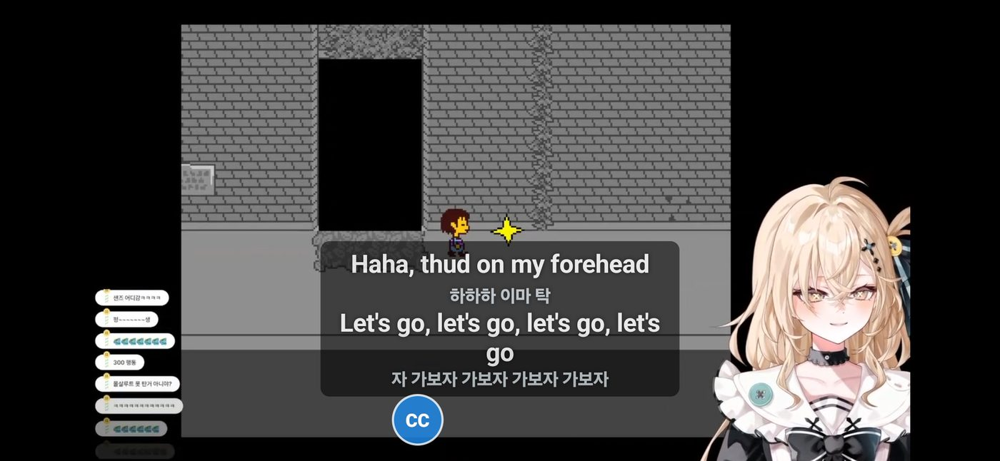

# CHZZK Live Translator

**English | [한국어](README.ko.md) | [日本語](README.ja.md)**

A Chrome extension — and now an **Android app (beta)** — that turns Korean speech on [CHZZK](https://chzzk.naver.com) live streams and replays into **live subtitles in your language**, and **translates the chat** as it scrolls by.



> **Disclaimer**
> - This is an unofficial, fan-made, non-commercial project for personal and fan use. It is not affiliated with, endorsed by, or sponsored by NAVER, CHZZK, Stellive or any streamer. All names and trademarks belong to their owners.
> - It does not download, record, save or re-upload any stream. It only listens to the audio and reads the chat of the page you are watching (short audio pieces go to the speech service you choose, see Privacy) and shows translations on your own screen.
> - Use it at your own risk. Translations can be wrong, and it is provided "as is" without warranty (see [LICENSE](LICENSE)).
> - If a rights holder, NAVER/CHZZK or a streamer has a problem with this project, please open an issue and I will change or remove it promptly.

*Built with the help of [Claude](https://claude.ai) (Anthropic), an AI assistant.*

## Features

- Live subtitles over the video player, in English, Japanese, Chinese, Spanish and more
- Chat translation under each message (nicknames are left alone; copy-paste spam is translated once and shown as "×N")
- **Foreign chat → 한국어**: chat written in English, Japanese, Chinese and other languages can be translated into Korean — handy for Korean viewers and streamers (off by default)
- **Built-in StelLive terms**: member names, fan names, greetings and memes in an English and a Japanese version, so Whisper spells names right and translations stay consistent (High accuracy mode and the Android app; on by default)
- **Stream title** translated right under the title (live and replays)
- Works on live streams and replays
- [Android app (beta)](#android-app-beta): subtitles and chat translation **on top of the official CHZZK app**
- Two modes:

| Mode | Speech recognition | Translation | API keys | Limits |
|---|---|---|---|---|
| **Free** (default) | Chrome's built-in speech recognition | Chrome's built-in translator | None | None |
| **High accuracy** | Whisper large-v3 (Groq, free tier) | NVIDIA AI (optional) or Chrome's translator | Your own free Groq key; NVIDIA key optional | About 8 hours of Whisper per day, then Free mode takes over automatically |

Start with **Free**. If the subtitles miss too much (fast talking, game sound, unclear pronunciation), switch to **High accuracy**.

## Requirements

- Desktop Google Chrome, version 138 or newer (Free mode needs Chrome's built-in translator)
- On Android phones, use the [Android app (beta)](#android-app-beta). iPhone / iPad are not supported.

## Install (Chrome extension)

This is a normal Chrome extension that you load by hand (no Chrome Web Store needed). It takes about a minute.

1. **Download**: open the [latest release](https://github.com/pst10101/chzzk-live-translator/releases/latest) and click the extension zip **`chzzk-live-translator-v1.x.x.zip`** under *Assets* (the number may be newer).
2. **Unzip**: right-click the zip → **Extract All** (Windows) or double-click it (Mac). Put the folder somewhere permanent, like `Documents`. Chrome reads the extension from this folder every time, so **do not delete or move it** afterwards.
3. Open **`chrome://extensions`** in Chrome (type it in the address bar).
4. Turn on **Developer mode** (switch in the top right).
5. Click **Load unpacked** (top left) and select the unzipped folder, the one that directly contains `manifest.json`. If you see only one more folder inside, open it and select that one.
6. **CHZZK Live Translator** now appears in the list. Click the puzzle icon in Chrome's toolbar and **pin** it so the icon is always visible.

> If a CHZZK tab was already open, refresh it once.

**Update later**: download the new zip, replace the old folder's files with the new ones, then press the circular arrow on the extension's card in `chrome://extensions`.

**Trouble?** "Manifest file is missing or unreadable" means you selected the wrong folder (go one level deeper or up). If *Load unpacked* is missing, Developer mode is off.

## Use (Free mode)

1. Open a CHZZK live stream and make sure it is playing with sound.
2. Click the extension icon → keep **Free** selected → choose a language in **Translate into**.
3. Click **Start live subtitles**.
4. The first time, Chrome may need to download its translator. If you see *"Click here to download the free … translator"* on the player, click it once.

While someone is talking, the Korean text appears in grey; when the sentence ends it turns into the translation. Chat and the stream title are translated automatically (turn off **Translate chat & title** to stop it).

To also translate chat written in **other languages into Korean**, turn on **Foreign chat → 한국어**. Those translations are shown in green. In Free mode, Chrome may ask you once to click a message on the player to download a translator into Korean.

## Android app (beta)

A separate app for Android phones. Keep watching in the **official CHZZK app** (or a browser) — the translator runs on top of it:

- **Speech → subtitles** floating over the video, with the Korean original underneath if you like.
- **Chat on screen → your language**: you mark where the chat is, the app reads it and shows the translation in a small panel. The screen picture is read **on your phone** (Google ML Kit text recognition) and never uploaded; only the recognised chat text is sent for translation.
- Turn each one on or off, in the app or from the floating **CC** button.

- Android 10 or newer
- **A free Groq key is required** (see [Groq key](#groq-key-speech-recognition--required-for-high-accuracy)). An NVIDIA key is optional and takes load off Groq's free limits. The phone has no Free mode (Chrome's built-in speech and translator aren't available to apps).
- Installed from an APK file, not the Play Store. It's a **beta** tested on few phones — please report problems in [Issues](https://github.com/pst10101/chzzk-live-translator/issues).

### Install

1. On your phone, open the [latest release](https://github.com/pst10101/chzzk-live-translator/releases/latest) and download **`chzzk-live-translator-android-v1.x.x.apk`**.
2. Open the downloaded file. Android asks to allow installing apps from this source (your browser or Files app): allow it, go back, and tap **Install**. If Play Protect warns that the app is unknown, tap **More details → Install anyway**.
3. Open **CHZZK Live Translator**, paste your **Groq key**, pick **Translate into**, and choose what to translate (speech, chat or both).

### Use

1. Tap **▶ Start translating** and allow the two permissions Android asks for:
   - **Display over other apps** — to draw subtitles, the chat panel and the CC button on top of the CHZZK app.
   - **Screen recording** — to hear the stream's sound and, if chat translation is on, read the chat area. Nothing is recorded or saved.
2. Open a stream in the CHZZK app (the **CHZZK ↗** button opens it). Subtitles appear a few seconds after someone speaks.
3. For chat: tap the floating **CC** button → **Chat area…**. Drag the **blue box** over the chat and the **green box** to where the translation should go; drag a corner to resize, then **Save**. Portrait and landscape are saved separately.
4. When you're done, tap **CC → ■ Stop** (or **Stop** in the notification).

- The CC menu turns subtitles and chat translation on/off while you watch; drag the button anywhere.
- The app settings also have text size, subtitle height, Whisper timing, the StelLive terms and your own names & terms.
- Groq's free limits: Whisper about 8 hours a day; translation models 1,000 requests a day each. When a limit is reached the app says so on screen and continues when it resets. Adding an NVIDIA key helps a lot.
- While it's on, sound from other apps can be captured too — stop it when you're done.

## Getting API keys (High accuracy mode)

Both keys are free and need no credit card. **Groq is the one that matters** — it is what makes recognition much more accurate. NVIDIA is optional.

### Groq key (speech recognition) — required for High accuracy

1. Go to **https://console.groq.com** and sign up with email, Google or GitHub.
2. In the left menu, open **API Keys**.
3. Click **Create API Key**, give it any name (for example `chzzk-translator`), and confirm.
4. **Copy the key right away** — it starts with `gsk_` and is shown only once. If you lose it, delete it and create a new one.

Free tier limits: 2,000 requests and 8 hours of audio per day, per account. The **Whisper timing** setting in the popup decides how you spend them:

| Whisper timing | Subtitle delay | Whisper per day |
|---|---|---|
| **All day** (default) | about 15 seconds | about 8 hours |
| **Fast** | about 5–10 seconds | about 3–5 hours |

When the free limit runs out, the extension **automatically switches to Chrome's free speech recognition** (Free mode) and switches back to Whisper when the limit resets. Subtitles never stop.

### NVIDIA key (AI translation) — optional

Without this key, Chrome's built-in translator is used. With it, translations handle slang and memes more naturally.

1. Go to **https://build.nvidia.com** and sign in, or create an NVIDIA account.
2. Open any model page (for example *llama-3.3-70b-instruct*) and click **Get API Key** → **Generate Key**.
3. The first time, NVIDIA asks you to **verify your phone number by SMS**. Some countries are not in the list — if yours is missing, just skip NVIDIA.
4. Copy the key — it starts with `nvapi-`.

Free tier limit: about 40 requests per minute. Subtitles are translated first; in very fast chats the newest messages are translated first.

### Put the keys in the extension

1. Click the extension icon → select **High accuracy**.
2. Open **API keys & models** and paste the Groq key (and the NVIDIA key if you have one).
3. Click **Test keys** — you should see ✓.
4. Click **Start live subtitles**.

### Keep your keys safe

- Keys are saved **only in your own Chrome** (`chrome.storage.local`). They are never in this project's code.
- **Never** put your key in the code, a commit, an issue, or a screenshot. Anyone who has it can use up your free limit.
- If a key leaks, delete it in the Groq console / NVIDIA site and create a new one.

## Tips

- **Names & terms** (under *API keys & models*): write streamer names and common words, one per line. Optionally add how to translate them:

  ```
  멤버이름 = Member Name
  자주 쓰는 말 = how to translate it
  별명 = Nickname | who or what it is (a note for the AI, never shown)
  ```

  This helps Whisper spell names correctly and keeps translations consistent.
- **Built-in StelLive terms** (switch under *API keys & models*, on by default) adds StelLive member names, fan names, greetings and memes automatically: the Japanese version when you translate into Japanese, the English version otherwise (for other languages only the official name spellings are fixed). Your own *Names & terms* are used first. Turn it off when you watch other streamers. The lists are in [`glossary/`](glossary).
- **Move the subtitles**: drag them anywhere on the video; the spot is remembered. In the popup, **Subtitle position → move** shows a sample line to drag while nobody is talking, and **reset** puts them back at the bottom.
- **Subtitle size** and **Show Korean under subtitles** are in the popup.

## FAQ

**Why does everyone need their own Groq key?**
Each Groq account has its own free limit. If you use your own key, your viewing uses only your limit — the project needs no server and costs nothing for anyone. A key shared by many people would run out within minutes.

**Is it really free?**
Yes. Free mode needs nothing. High accuracy uses Groq's and NVIDIA's free tiers; you never enter payment details in this extension.

**Can I use it on my phone?**
On Android, yes — install the [Android app (beta)](#android-app-beta). iPhone / iPad are not supported.

## Privacy

- Free mode: the stream's audio goes to Chrome's speech recognition service; translation happens on your computer.
- High accuracy mode: the stream's audio goes to Groq; text goes to NVIDIA if you added an NVIDIA key.
- Android app: the stream's sound goes to Groq; text (subtitle lines and recognised chat lines) goes to NVIDIA if you added an NVIDIA key, otherwise to Groq. The chat area is read from the screen on the phone itself — screen pictures are never sent anywhere. Keys are stored only inside the app on your phone.
- Nothing is sent anywhere else, and neither the extension nor the app collects any data.

## Troubleshooting

| Problem | Fix |
|---|---|
| "Reload the CHZZK page once" | Refresh the CHZZK tab and start again |
| No subtitles in Free mode | Make sure the stream is playing; if the player is muted, raise the volume a little; update Chrome |
| "Click here to start free subtitles" | Click that message once |
| Only Korean, no translation | Free: click the translator download message, or pick another language. High accuracy: check the NVIDIA key or remove it to use Chrome's translator |
| Translation model not found | In *API keys & models*, click **load list** and pick another model |
| Chat is not translated | CHZZK may have changed its page layout — update `TEXT_SEL` in `content.js` |
| Android: no subtitles / "Couldn't capture the sound" | Make sure the stream is playing with sound, then start again. If Android asks what to share, choose the **entire screen**. Some apps don't allow their sound to be captured |
| Android: Korean only / "Translation error (404)" | Update the app (v1.1.0 or newer): Groq retired the translation models older versions used |
| Android: chat isn't translated | CC → **Chat area…** and put the blue box exactly over the chat lines; check chat translation is on in the CC menu |
| Android: can't install the APK | Allow installing from your browser or Files app; the app needs Android 10 or newer |

## For developers

| File | What it does |
|---|---|
| `manifest.json` | Extension manifest (Manifest V3) |
| `popup.*` | Settings popup |
| `engine-main.js` | Free engine (runs in the page): video audio → Chrome speech recognition, Chrome translator |
| `content.*` | Subtitle overlay, chat translation, bridge to the engine |
| `background.js` | High accuracy: start/stop capture, NVIDIA translation, usage counter |
| `offscreen.*`, `pcm-worklet.js` | High accuracy: tab audio capture, cut at pauses, send to Groq |
| `audio-utils.js` | Resampling, speech chunking, WAV encoding, hallucination filter |
| `translate-utils.js` | Translation prompts and response parsing |
| `glossary/` | Built-in StelLive terms (`stellive-en.txt`, `stellive-ja.txt`), shared with the Android app |
| `chat-utils.js` | Which chat lines to translate and in which direction |
| `android/` | Android app (Java; on-device chat reading with Google ML Kit text recognition). Build: JDK 17 + Android SDK 34, then `gradle assembleDebug` in `android/` |

## License

[MIT](LICENSE)
